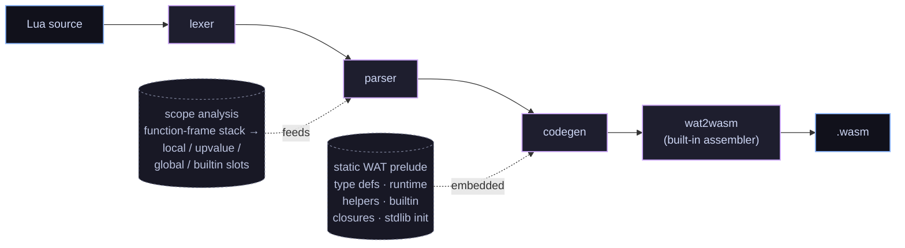

# lua2wasm

**An ahead-of-time compiler that turns Lua 5.5 source into standalone WebAssembly modules — no interpreter, no bytecode VM, no bundled garbage collector.**

`lua2wasm` leans on the modern WebAssembly type system — the garbage-collection,
typed function reference and exception-handling proposals — so the output uses
no linear memory at all.

Lua tables become real WebAssembly structs, closures become typed function
references, and the host's garbage collector (V8 / SpiderMonkey) owns every
value.

## Try it now — no install required

**Live playground:** <https://rhmoller.github.io/lua2wasm/>

Type Lua on the left and see the result on the right — the page compiles and
runs your program entirely in the browser, with nothing to download. Flip the
output to **Show WAT** to read the generated WebAssembly text. Works in any
recent Chrome, Edge, Firefox, or Safari (see [Targets](#targets)).

It integrates with just-bash so even the `os` and `io` packages can be used on the web.

Prefer the command line? See [Build & run locally](#build--run-locally).

## A tiny example

```lua
-- A "Stack" class — exercises tables, metatables, OO sugar, closures,
-- errors, and pcall in one short program.

local Stack = {}                        -- a Lua table → a `$LuaTable` struct:
Stack.__index = Stack                   --   array part + open-addressed hash + `meta` slot

function Stack.new()
  return setmetatable({n = 0}, Stack)   -- writes Stack into the struct's `meta` field
end                                     -- `Stack.new` itself is a `(ref $LuaClosure)` =
                                        --   struct (funcref code, upvalue array)

function Stack:push(v)                  -- `:` desugars to `self` as the first parameter
  self.n = self.n + 1                   -- small ints unbox to `i31ref` — zero allocation
  self[self.n] = v                      -- integer keys land in the dense array part
end

function Stack:pop()
  if self.n == 0 then
    error("stack underflow")            -- compiles to `throw $LuaError` (anyref payload)
  end
  local v, n = self[self.n], self.n
  self[n], self.n = nil, n - 1
  return v
end

local s = Stack.new()
s:push("hi"); s:push("from"); s:push("lua2wasm")
-- each string literal is a module global, built once with its hash precomputed

for i = 1, s.n do print(s[i]) end       -- numeric `for` keeps `i` as a raw `i64`;
                                        -- the call to `print` dispatches via `call_ref`

local ok, err = pcall(function()        -- `pcall` → `try_table (catch $LuaError ...)`
  for _ = 1, 4 do s:pop() end           -- the 4th `pop` underflows and throws
end)
print(ok, err)                          --> false   <src>:19: stack underflow
```

That compiles to a ~38 KB `.wasm`. Tree-shaking is automatic here, since the
program is *globally closed* (no `_G`/`_ENV`/`load`/`require`), though its
field reads keep the `string` library live (`self.n` could be a string method
lookup); a bare `print("hi")` shrinks to ~12 KB, and programs that aren't
closed keep the full ~54 KB runtime.
Every value is a host-GC object — the host's garbage collector owns lifetimes,
there is no linear memory and no bundled allocator. The Stack instance is a
real `$LuaTable` struct (array + hash + `meta` slot, all GC fields); the
`:push` / `:pop` methods are `(ref $LuaClosure)` values carrying a typed
`funcref` plus an upvalue array; every call dispatches through `call_ref`,
the WASM indirect-call instruction for typed function references; and
`error` / `pcall` ride directly on the exception-handling proposal — a real
`throw $LuaError` thrown across frames and caught by a `try_table`, with no
setjmp/longjmp emulation. The full mapping from each Lua construct to the
WASM feature it lowers to is in
[How we use modern WebAssembly](#how-we-use-modern-webassembly).

## What works today

`lua2wasm` is an AOT compiler. There's no Lua interpreter sitting around at
runtime; what you write is what the compiler *statically* lowers to WASM
instructions.

Most Lua code will compile and run on `lua2wasm`. The two primary limitations are:

- no runtime compilation or interpreter, so `load` and `loadfile` are not supported
  (`require` works for modules linked in at compile time with `-m`).
- no coroutines (waiting for stack switching to ship in WebAssembly engines).

| Area              | Supported                                                                                                                                                                                                                                                                       | Not yet                                                          |
|-------------------|---------------------------------------------------------------------------------------------------------------------------------------------------------------------------------------------------------------------------------------------------------------------------------|------------------------------------------------------------------|
| **Values**        | `nil`, booleans, integers, floats, strings, tables, first-class functions / closures                                                                                                                                                                                                                            | userdata, threads                                                |
| **Numbers**       | int + float subtypes with Lua-compliant promotion (`/` always float, `+ - *` keep int if both ints, `//` floor-div, `%` floor-mod, `^` always float, hex int `0xFF` / `0Xff` (wraps mod 2^64 like reference Lua — `0x13121110090807060504030201` denotes its low 64 bits), hex float `0x1.8p3`, bitwise `& \| ~ << >>` and unary `~` on 64-bit ints with float-to-integer coercion)                            | —                                                                |
| **Strings**       | single / double-quoted with full escape set (`\n \t \\ \" \' \0 \a \b \f \r \v \xHH \ddd \u{…} \z \<line-break>`), **long-bracket `[[ ... ]]`** and level-N `[=[ ... ]=]`, concat `..` (with `__concat`), length `#` (with `__len`), structural equality                                                         | —                                                                |
| **Tables**        | array part + hash part, positional / named / `[expr]=` constructors, `t.k` and `t[k]` read+write, nil-assignment delete, `#t` border rule, nesting, identity equality via `ref.eq` (table keys work as in Lua)                                                                                                  | —                                                                |
| **Locals**        | `local x`, `local x, y, z = …`, lexical block scoping, shadowing, **`<const>` (compile-time reassignment error)** and **`<close>` (calls `__close` in reverse declaration order on every scope exit — fall-through, `return`, `break`, `goto` and error unwinding, the error passed as a second argument; nil/false skip)**                                                                                                                                                                                                                              | —                                                                  |
| **Globals**       | Lua-traditional implicit globals — `num = 42` at top level just works; reading an undeclared name yields `nil`. Explicit `global x` declarations also supported. **`_G` is a real `$LuaTable` aliasing every global**: builtins, library tables, user globals all live there, `_G._G == _G`, `pairs(_G)` iterates them. Reassigning a builtin (e.g. `print = my_print`) writes a new `_G` entry — the original stays reachable through any local that captured it. | Lua 5.5's compile-time rejection of undeclared globals once a chunk uses `global` declarations |
| **Statements**    | `local`, `local function`, **top-level `function f() end`** incl. dotted (`function T.x.y() end`) and method (`function T:m() end`) forms, multi-assign, `if/elseif/else`, `while`, `for i = a,b[,c]`, generic `for k[,v,…] in …`, `repeat ... until`, `break`, **`goto NAME` / `::NAME::`**, bare `do`, expression-statement, `return e1, …` | —                                                                |
| **Operators**     | `+ - * / // % ^`, `& \| ~ << >>` (binary) and `~` (unary, bitwise NOT), `== ~= < <= > >=`, `and or not`, `..`, `#`                                                                                                                                                                                              | —                                                                |
| **Functions**     | N-ary arguments, multiple return values (`return a, b, c`), upvalue capture (mutable shared boxes), transitive captures, **method-call sugar `obj:m(args)`**, **paren-less single-arg call `f"x"` / `f{k=1}`**, **varargs `function f(...)` / `function f(a, ...)` with `...` spliced into call args, returns, table constructors, and multi-assign; Lua 5.5 named vararg tables `function f(...t)` (a read-only `{..., n = count}` that `...` reads back)**, proper tail calls (`return f(...)` → `return_call_ref`, doesn't grow the stack)                  | —                                                                |
| **Errors**        | `error(v)` / `pcall(f, …)` / `xpcall(f, msgh, …)` / `assert(v[, msg])` lowered to WASM exception handling (`throw $LuaError` + `try_table`); as in reference Lua, xpcall's handler runs where the error is raised, before to-be-closed variables close. Internal builtins raise spec-shaped messages with the standard `<src>:<line>:` position prefix — `attempt to perform arithmetic`, `attempt to index a value`, `invalid UTF-8 code`, `data does not fit`, `out of limits`, `variable-length format`, `not power of 2`, `table overflow` (raised before WASM array-size traps so `pcall` can catch runaway allocations), `stack overflow` (a stack-budget guard raises it catchably before deep non-tail recursion exhausts the host call stack), etc. | full traceback (`debug.traceback` returns the current frame only) |
| **Metatables**    | `setmetatable` / `getmetatable`, `__index` (table chain *and* function form, with cycle limit), `__newindex` (table chain *and* function form), `__add` `__sub` `__mul` `__div` `__mod` `__pow` `__unm` `__idiv` `__band` `__bor` `__bxor` `__shl` `__shr` `__bnot`, `__concat`, `__len`, `__eq` `__lt` `__le`, `__call`, `__close`, `__pairs`, `__tostring`, `__name` (renames the type in `tostring` and type-aware error messages), `__metatable` (protect)                                                                                                                                              | `__gc` (no finalizers in WasmGC), `__mode` (no weak refs in WasmGC) |
| **Standard lib**  | `print`, `error` (full position prefix `<src>:<line>:` via the level arg; level 0 disables it), `pcall`, `xpcall`, `warn`, `assert` (auto-prefixes too), `select`, `type`, `tostring`, `tonumber`, `ipairs`, `pairs`, `next`, `setmetatable`, `getmetatable`, `rawequal`, `rawlen`, `rawget`, `rawset`, `collectgarbage` (stub — no real Lua GC, but `"incremental"`/`"generational"` round-trip the previous mode), `_G`, `_VERSION`; `debug.{traceback, getmetatable, setmetatable, gethook}`; **`require` + `package.{loaded, preload}`** (static `-m FILE` modules at compile time — see CLI section); `io.{write, read, output, input}` (`io.output([f])` / `io.input([f])` query or set the default file; bare `io.write` / `io.read` route through it) plus **`io.stdout` / `io.stderr` / `io.stdin` file handles** with `:write` / `:read` / `:close` / `:flush` methods (`close`/`flush` are no-ops on the standard streams; stderr writes route to the host's stderr); **real files via `io.open` / `io.lines` / `io.type`** returning handles with `:read` (`l`/`L`/`a`/`n`/N-byte) / `:write` / `:seek` (`set`/`cur`/`end`) / `:flush` / `:close` / `:lines` — backed by `node:fs` under Node and by [just-bash](https://github.com/vercel-labs/just-bash)'s in-memory FS in the playground (bridged through JSPI, persists for the page session); `os.{time, clock, date, difftime, getenv, exit, execute, remove, rename, tmpname, setlocale}` — light shims over the host. `os.difftime(t2,t1)` returns the second difference as a float; `os.setlocale` supports the portable `"C"` locale (other locale names → nil). `os.time`/`os.clock` are real, `os.date` covers a strftime subset (`%Y %m %d %H %M %S %j %p %w %y %c %x %X %%`) plus the `*t` / `!*t` table form, `os.execute()` reports "shell available" and `os.execute(cmd)` returns `(nil, "exit", 1)`, `os.{remove, rename}` act on the host filesystem and return `(nil, msg)` on failure; `math.{floor, ceil, abs, sqrt, min, max, sin, cos, tan, asin, acos, atan, exp, log, pi, huge, deg, rad, fmod, modf, tointeger, type, ult, maxinteger, mininteger, random, randomseed}` (`atan`/`log` accept a second arg; numeric-string args coerce like the operators, and a non-number raises a catchable `number expected`); `string.{len, sub, format, upper, lower, reverse, rep, byte, char, find, match, gmatch, gsub, pack, unpack, packsize}` (`format` covers all of `%s %d %i %u %o %x %X %c %q %e %E %f %g %G %a %A %%` with flags `- + space # 0`, width, precision; pattern subsystem covers every documented class, set, quantifier, anchor, capture, back-ref, `%bxy` balanced match, `%f[set]` frontier; gsub accepts string/table/function repl; pack/unpack/packsize cover every option in §6.5.2 — `< > = ! [n] b B h H l L j J T i[N] I[N] f d n c[N] z s[N] x Xop` — and round-trip byte-for-byte with reference Lua, including `data does not fit` overflow detection on `>8`-byte ints in either direction); `table.{insert, remove, concat, unpack, pack, move, create, sort}`; `utf8.{char, len, codepoint, offset, codes, charpattern}` (codes raises `invalid UTF-8 code` with file:line on bad bytes); `load` returns `(nil, "no load")` since lua2wasm is AOT — no runtime compiler ships with the module | `loadfile`, `coroutine`, the rest of `debug` |
| **Coroutines**    | —                                                                                                                                                                                                                                                                                                               | blocked on the WASM stack-switching proposal shipping in browsers |

Browse [`tests/fixtures/`](tests/fixtures/) to see what valid programs look
like across each capability area.

## How we use modern WebAssembly

The whole point of `lua2wasm` is to take the new WASM proposals seriously —
**not** as a portable assembler with a hand-rolled allocator on top, but as a
managed runtime that already has most of what a dynamic language needs.

| WASM feature                                  | What we use it for                                                                                                                                          |
|-----------------------------------------------|-------------------------------------------------------------------------------------------------------------------------------------------------------------|
| **GC: `struct` and `array` types**            | Every Lua value is a host-GC object. `$LuaString` wraps `(array i8)`, `$LuaTable` is a struct of (shared key shape, values, array part, metatable), `$LuaClosure` is a struct of (funcref, upvalues). **No linear memory.** No bundled allocator. The browser's GC owns lifetime. |
| **`i31ref`**                                  | Unboxed small integers. Lua ints in the 31-bit range live as tagged immediates with zero allocation; only overflowed ints get boxed in `$LuaInt`.            |
| **Typed function references + `call_ref`**    | Closures are *real* references, not table-of-functions indices. Every function call goes through `call_ref` on a `(ref $LuaFn)` extracted from the closure struct. |
| **`return_call_ref` (tail calls)**            | `return f(...)` lowers to `return_call_ref`. Deep recursion (e.g. 20 000-step countdown) doesn't grow the WASM call stack — a property the JS embedding can't offer. |
| **Mutually-recursive types (`rec` blocks)**   | `$LuaClosure` references `$LuaFn`, `$LuaFn` mentions `$LuaClosure`. We declare them in a single recursion group so the type system accepts the cycle. Same trick for `$LuaTable` referencing itself via its metatable field. |
| **Reference-type tests / casts**              | Dynamic dispatch (e.g. `print` of arbitrary values, or `+` falling back to `__add`) uses `ref.test (ref $LuaTable)`, `ref.cast`, `ref.is_null` to switch on the type without a tag word. |
| **Exception handling (`tag` + `throw` + `try_table`)** | `error(v)` is `throw $LuaError v` carrying the error as an `anyref` payload. `pcall(f, ...)` is `try_table` with a single catch label that lands the error value on a block exit. Real call-stack unwinding, no setjmp/longjmp emulation. |
| **`array.new_fixed` / `array.new_data`**      | Constant strings up to 256 bytes are immutable module globals built with `array.new_fixed` (a constant expression), their hash precomputed; longer ones, and the runtime's own messages, are one `array.new_data` copy out of a shared data segment. |
| **`array.copy` between GC arrays**            | String concat and table-array resizing copy ranges between GC-managed `(array …)` instances directly — no manual loop, no memcpy, no linear-memory staging. |
| **`anyref` + null tracking in the type system** | Lua values flow as `anyref`. Non-nullable refs (`(ref $X)` vs `(ref null $X)`) are tracked separately so the validator catches whole classes of NPE-style bugs in our generated code at module-instantiation time. |
| **`(start)` *not* used**                      | We *deliberately don't* run code at instantiation time, so the JS host can wire up its decoder helpers before `main()` is called — otherwise imports couldn't see the module's own exports. |
| **JS Promise Integration** (`WebAssembly.Suspending` / `WebAssembly.promising`) | *Playground only.* `io.read` and the filesystem imports (`io.open`/`io.lines`/`os.remove`/…, backed by just-bash's async in-memory FS) are wrapped as suspending imports and `main` as a promising export, so synchronous Lua I/O transparently awaits the async host underneath. No change to the compiled `.wasm`; pure host-side. Falls back to EOF / soft I/O failure when the host lacks JSPI. |

The practical consequence: the host has zero Lua-specific runtime; everything
that *is* the Lua VM lives in the produced `.wasm`, which is tens of KB — ~12 KB
for a tree-shaken `print("hi")` or a small closure demo, ~54 KB with the whole
standard library.

## Performance

Does the "no linear memory, everything is a host-GC object" model cost
runtime speed? **It doesn't have to.** Hand-writing the *ideal* WAT for a
numeric loop — plain `i64`/`f64` locals, no boxing — runs at par with (or
faster than) reference Lua 5.5's bytecode interpreter on V8. The baseline gap
is *representation overhead*, not the execution substrate: boxed floats,
per-call argument/result arrays, and generic `anyref` dispatch through runtime
helpers. So it's recoverable by generating better code.

A numeric/call specialization pass closes it for monomorphic code, and it is
**on by default** — `-O0` selects the boxed fallback, which is behaviour-
identical, just slower. Measured under Node/V8, timed inside the script with
`os.clock()` so process startup is excluded (numbers vary by machine; compare
the columns, not the absolutes):

| tight loop                                        | reference `lua5.5` | lua2wasm (`-O0`, boxed) | lua2wasm (default) |
|---------------------------------------------------|-------------------:|------------------------:|-------------------:|
| `s = (s + i * 3) % 1000003`, 20M times            | 0.09 s             | 0.27 s                  | **0.05 s** |
| `x = x * 0.5 + i * 0.25` (floats), 20M times      | 0.09 s             | 0.42 s                  | **0.03 s** |
| `s = add(s, i)`, a local function, 20M times      | 0.22 s             | 0.65 s                  | **0.01 s** |
| recursive `fib(34)`                               | 0.19 s             | 0.25 s                  | **0.03 s** |
| `t[i] = i` 5M times, then sum `t[1..#t]`          | 0.04 s             | 0.26 s                  | 0.04 s |

Those are microbenchmarks, mostly over unboxed locals. `scripts/bench.sh` runs a set of
*realistic* programs (`bench/*.lua`: nbody, binary-trees, fannkuch,
spectral-norm, a metatable-OO particle sim, string processing, closures, hash
tables, and game-logic shapes — an entity system with class hierarchies and a
state machine, a structure-of-arrays particle system, tile-map A* / flood
fill, an immutable-vector math library) under `lua5.5`, `luajit` and
lua2wasm, checks the outputs match, and prints the ratio to reference.
Seconds, best of five, Node 24.21 on one machine. Times are `os.clock()`, CPU
time, which for lua2wasm includes V8's background compiler and GC threads; the
wall-clock ratio is the fairer comparison with single-threaded Lua:

| program (`bench/`) | reference `lua5.5` | lua2wasm | ratio | wall-clock ratio |
|--------------------|-------------------:|---------:|------:|-----------------:|
| binarytrees        | 0.36 | **0.12** | 0.32× | 0.25× |
| fannkuch           | 0.83 | **0.33** | 0.40× | 0.40× |
| oo                 | 0.46 | **0.26** | 0.56× | 0.53× |
| spectralnorm       | 0.89 | **0.53** | 0.59× | 0.59× |
| nbody_arr          | 0.39 | **0.23** | 0.60× | 0.59× |
| vectors            | 1.08 | **0.67** | 0.62× | 0.57× |
| particles          | 0.59 | **0.46** | 0.77× | 0.72× |
| nbody              | 0.44 | **0.35** | 0.80× | 0.80× |
| tilemap            | 0.29 | **0.23** | 0.81× | 0.65× |
| entities           | 0.67 | **0.55** | 0.83× | 0.75× |
| closures           | 0.08 | **0.07** | 0.88× | 0.65× |
| hashtab            | 0.10 | 0.10 | 1.01× | 0.68× |
| strings            | 0.07 | 0.10 | 1.55× | 0.87× |

By the wall clock every program runs ahead of reference Lua; by CPU time only
dictionary-heavy code (at par) and string processing (1.55×, largely V8's
helper threads on a run this short) don't. What closed the gap from the 6–10×
the table-field and string-heavy programs started at:

- **Constant strings are hoisted into module globals** with their hash
  precomputed, so `t.name` never allocates its key and the same literal is
  the same object at every site; every string caches its hash, and table
  lookups compare identity, then hashes, then bytes. Constant-key reads,
  writes, constructors, method dispatch and metamethod fetches go through
  string-specialized entry points that skip the generic key dispatch.
- **Maybe-typed locals** ([design note](docs/design/22-maybe-typed-locals.md)):
  a local or parameter fed from a table field, a call or `x or 0` and used
  in arithmetic is speculated int or float — a tag plus unboxed `i64`/`f64`
  slots with the boxed value as fallback — classified once per store.
  Arithmetic and comparisons over such values run inline on the fast tags
  and fall back to the generic runtime helper (same operands, same errors)
  otherwise; `math.sqrt`/`abs`/`floor`/`ceil` inline behind an identity
  guard on the callee.
- **Unboxed float storage in tables**: a float written from such a tree is
  stored as a raw `f64` in a parallel array and read back into the next
  computation without allocating, so nbody's inner loop allocates nothing.
- **`string.format` parses and renders directives in wasm**; only float
  rendering crosses to the host, and the host takes a native formatting path
  whenever no decimal rounding tie is possible.
- **Common idioms stay on the fast paths**: `for i = 1, #t` (any limit, settled
  once at loop entry) runs on an `i64` counter; a float compared with an
  integer (`x > 0`) compares unboxed, exactly; a local used only as a table
  key (`local id = alive[i]; life[id]`) is maybe-typed; and multi-target
  stores (`px[id], py[id] = x, y`) go through the same unboxed setters as
  single stores instead of staging arrays.
- **Shared table shapes and inline caches**
  ([design note](docs/design/23-table-shapes.md)): tables built with the same
  string keys in the same order share one immutable key layout, so a
  constructor allocates just the table and its values, and every `t.name`
  site and `obj:m()` call caches the layout it last saw — a field read is an
  identity check plus a load, a method lookup five identity checks.
- **Calls through closures pass arguments in registers**: every closure
  carries a single-result entry taking up to four arguments, which method
  calls, calls through tables and metamethods use instead of building
  argument and result arrays.
- **The array part allows holes**, like reference Lua's, so clearing
  elements of a list never moves the whole array into the hash part.
- **Loops in code that runs once get optimized too**
  ([design note](docs/design/24-run-once-loops.md)): V8 switches a wasm
  function to optimized code only for its next call, so the main chunk's
  loops — and those of a function the chunk calls once — would stay on
  baseline code for their whole life. Each becomes a function of its own that
  returns every 64K iterations and is called again: fannkuch runs 2.2×
  faster, particles 1.35×.
- **Integer keys and iteration stay inline**: integer-key reads and writes
  probe the array part in place, `t[#t + 1] = v` and `#t` skip the generic
  path, and a generic `for` over `ipairs` / `pairs` steps the table itself
  instead of calling the iterator.
- **Strings are cheap to build**: a long `..` result is lazy until read
  ([design note](docs/design/25-string-ropes.md)), so appending in a loop
  doesn't copy the whole string each time; short strings made at run time go
  through a small lossy cache; and string receivers share the method cache.

[`docs/perf-backlog.md`](docs/perf-backlog.md) has the measurements behind
each of these, what was measured and set aside, and how to profile.

What the pass does, all within the WasmGC model (no linear memory, no deopt):

- **Unboxes locals, parameters, returns, and recursion.** A whole-program
  fixpoint infers which slots, function parameters, and return values are
  monomorphically `int` or `float`, and declares them as raw `i64`/`f64`.
  Integer and float are kept *distinct* (Lua semantics: `3*3` is `9`, `3.0*3.0`
  is `9.0`), so a value seen as both stays boxed.
- **Specializes arithmetic and comparisons** to native `i64`/`f64` opcodes;
  comparisons in `if`/`while`/`repeat` use the `i32` result directly, skipping
  the boxed boolean and the truthiness helper.
- **Direct calls.** A call to a statically-bound local function — including a
  self-recursive one — goes to a typed entry that takes unpacked, unboxed
  arguments and returns an unboxed value, skipping the per-call argument and
  result arrays. End to end, `s = s + f(i)` in a loop compiles to an `i64.add`
  over a direct call with no allocation.

Independently, tables use a **hybrid array + hash representation** (always on,
not gated): integer keys `1..n` live in an array part for O(1) access — holes
allowed, as in reference Lua, so clearing an element never reshuffles the
table — with everything else in an open-addressing hash — the same shape
reference Lua uses. Table slots still hold `anyref`s (small integers as
`i31ref`, floats unboxed in a parallel `f64` array), so a `sum += t[i]` loop
runs at reference speed rather than ahead of it; numeric scalar code is where
the model shines.

The honest ceiling: genuinely *dynamic* float or big-integer code **must** box
(WasmGC has no way to put a raw `f64`/64-bit int in an `anyref`, and NaN-boxing
needs linear memory — which this project forbids), and an AOT compiler with no
deoptimization can't speculate the way a tracing JIT does. Conservative static
specialization plus a boxed generic fallback is the model's ceiling — and for
ordinary numeric and call-heavy code, that ceiling is at or below reference Lua.

## Targets

Anything with current WASM-GC + reference-types + exception-handling
support runs every compiled module:

- **Chrome / Edge** ≥ 137 — works out of the box, no flags
- **Firefox** ≥ 131 — works out of the box, no flags
- **Safari** ≥ 18.4 — works out of the box, no flags
- **Node** ≥ 22 — Node 22 needs `--experimental-wasm-exnref`; Node 24.21 has it
  on by default (the commands below pass the flag, which is harmless)

The new exception-handling proposal (with `exnref` / `try_table`) is the
only opcode family in our compiled output that was ever flag-gated. Every
current browser ships it by default; on older Node it is a runtime flag, not a
missing implementation.

### Optional: JSPI for interactive `io.read` in the playground

[`runtime/playground.html`](runtime/playground.html) uses **JavaScript
Promise Integration** (`WebAssembly.Suspending` + `WebAssembly.promising`)
to let `io.read` suspend the running wasm while it awaits a typed line in
the output pane. Status is the same as exnref:

- Chrome / Edge ≥ 137 — default-on
- Firefox / Safari recent — default-on (track the [JSPI proposal](https://github.com/WebAssembly/js-promise-integration) for the latest)
- Node — behind `--experimental-wasm-jspi` (not used by our CLI host)

When JSPI is unavailable the playground silently falls back to returning
EOF from `io.read` — every other feature keeps working. Nothing in the
compiled `.wasm` itself depends on JSPI; it's purely a host-side feature
that lets a synchronous-looking wasm import resolve a promise.

Compiled modules need no other runtime files. They import a small set of
`host` functions — output, float formatting and parsing, and the `io` / `os`
shims (files, clock, time, environment) — which [`runtime/host.mjs`](runtime/host.mjs)
implements for Node and the playground for the browser; an embedding supplies
its own.

## Build & run locally

The command-line flow needs **no Emscripten** and **no Binaryen** — just
`clang`, `cmake`, and Node ≥ 22. The WAT→wasm assembler is built into the
compiler.

```sh
# 1. Build the compiler (a native binary)
CC=clang cmake -S . -B build -G Ninja
cmake --build build

# 2. Compile a Lua program straight to a .wasm module
echo 'print("hello from " .. "lua2wasm")' > /tmp/hello.lua
./build/lua2wasm /tmp/hello.lua -o /tmp/hello.wasm

# 3. Run it
node --experimental-wasm-exnref runtime/host.mjs /tmp/hello.wasm
#   → hello from lua2wasm
```

Use `-o /tmp/hello.wat` to emit human-readable text instead. Run the full test
suite with `ctest --test-dir build --output-on-failure`.

Requirements (required vs optional):

| Tool       | Version  | Required for                                                                                                                         |
|------------|----------|--------------------------------------------------------------------------------------------------------------------------------------|
| `clang`    | ≥ 19     | building the native compiler binary (C23 `#embed` requires clang ≥ 19)                                                              |
| `cmake`    | ≥ 3.25   | building the native compiler binary                                                                                                  |
| `node`     | ≥ 22     | running compiled `.wasm` modules from the command line (Browser hosts work equivalently, no Node needed there)                       |
| `binaryen` | recent   | **optional** — `wasm-as` is used only as a differential oracle by the `wat2wasm` unit tests; the compiler ships its own WAT→wasm assembler |
| `wasm-ld`  | ≥ 19     | **optional** — only for the playground / embeddable build (`scripts/build-wasm.sh` cross-compiles the compiler to freestanding wasm with plain clang). Ships with LLVM/clang. Skip if you don't need it. |

## Using the CLI

```sh
./build/lua2wasm input.lua -o output.wasm   # binary module (use -o output.wat for text)
```

`-o .wasm` output runs **dead-code elimination** by default — prelude functions
and globals the program can't reach are dropped, along with the function-type
signatures left orphaned once those functions are gone (all behavior-preserving).

On top of that, **tree-shaking is automatic** for any program that is *globally
closed* — one whose set of named builtins/globals is statically complete because
it never mentions `_G`/`_ENV` and never calls `load`/`require`. For such programs
the builtins and libraries the source never reaches are pruned (e.g.
`print("hi")`: ~54 KB → ~12 KB), with no behavior change, since nothing can fetch
an un-named builtin at runtime. When the program *does* open one of those escape
hatches the full runtime is kept, so dynamic `_G["name"]` lookups still work.
Strings are special-cased: any method call or field index keeps the `string`
library live (it's the string metatable's `__index`). Pass `--force-tree-shake`
to *force* pruning even when the program isn't closed (it can make dynamic `_G`
lookups of un-named builtins return nil). As a further win, a
program that writes no tables of its own has `_G` and the library tables populated
by an append-only bootstrap insert, so the table grow/rehash write path is
dead-code eliminated entirely. `--no-dce` disables the DCE pass. `--embed-api`
exports the host-call ABI for embedders (see [Embedding for
scripting](#embedding-for-scripting-the-host-call-abi)); it keeps the whole
stdlib live, so it's the opposite of tree-shaking.

Run under Node:

```sh
node --experimental-wasm-exnref runtime/host.mjs output.wasm
```

Multi-file programs are linked at compile time via `-m`:

```sh
./build/lua2wasm main.lua -m util.lua -m wrap.lua -o output.wat
```

Each `-m FILE` becomes a require()-able module keyed by `basename(FILE)`
sans `.lua`. `require("util")` in any source (entry or module) walks
`package.preload`, calls the loader on first hit, and caches the result
in `package.loaded` — the standard Lua semantics, statically wired.

The numeric/call specialization pass (see [Performance](#performance)) is on by
default. To emit the boxed fallback instead — every value a host-GC object, no
unboxed `i64`/`f64` — compile with `-O0`:

```sh
./build/lua2wasm input.lua -O0 -o output.wat
```

## Packaging

`scripts/package-html.sh` wraps a compiled `.wasm` into a single
self-contained HTML page — base64-embeds the module plus a tiny host loader,
about 10 KB of HTML overhead. The result needs no server and no other
files.

```sh
./scripts/package-html.sh output.wasm -o output.html
# open output.html — runs in any GC-capable browser
```

### Building the playground (optional)

The [live playground](https://rhmoller.github.io/lua2wasm/) above is prebuilt,
but you can build it yourself with **plain clang + wasm-ld** — no Emscripten.
`scripts/build-wasm.sh` cross-compiles **the compiler itself** to a freestanding
wasm module (its own linear memory, its own minimal libc from `src/freestanding/`)
so the page compiles Lua entirely client-side: a CodeMirror editor on one side,
output on the other, with **Run** to execute and **Show WAT** to inspect the
generated WebAssembly (foldable prelude / stdlib / user code / data sections).
It is styled with the rhm/ui design system, with a light / dark toggle.

```sh
./scripts/build-wasm.sh                  # produces build-wasm/lua2wasm.wasm
python3 -m http.server 8000
# open http://localhost:8000/runtime/playground.html
```

The compiled module imports only `env.abort` / `env.log` and exports
`lua2wasm_compile` / `_compile_ex` / `_assemble` / `_dce_dead_names` / `_free` plus `malloc` /
`free` / `memory`; `runtime/lua2wasm-wasm.mjs` is the host glue that drives it.
Nothing in this repo needs Emscripten — the same freestanding module also
embeds into a C host (e.g. a game engine) that runs wasm the same way.

### Embedding for scripting (the host-call ABI)

To use compiled scripts as a scripting layer — call named Lua functions from
your host, pass and receive values, keep state across calls — compile with
**`--embed-api`** (or `embedApi: true` through the JS glue / `embed_api = 1`
through `lua2wasm_compile_ex`). It exports a small host-call ABI on the produced
module:

| Export | Use |
|--------|-----|
| `lua_str_new` / `lua_str_setb`, `lua_make_int` / `lua_make_float` | build Lua values to pass in |
| `lua_get_global(name)` | look up a global (e.g. your function) by name |
| `lua_args_new` / `lua_args_set`, then `lua_args_len` / `lua_args_get` | build arguments, read results (incl. multiple returns) |
| `lua_call(fn, args)` | invoke (Lua errors throw the exported `LuaError` tag) |
| `lua_pcall(fn, args)` | protected invoke → `[ok, ...results-or-error]`, safe to keep calling after a script errors |
| `lua_table_new` / `lua_table_get` / `lua_table_set` / `lua_table_len` | build/read/write Lua tables across the boundary |

A compiled script runs WasmGC + exception-handling, so the runtime side needs a
GC-capable engine (any browser, Node, or Wasmtime). Because `--embed-api` keeps
the whole stdlib reachable, it disables tree-shaking for that module — the trade
for a callable script. A worked end-to-end example (a C "engine" with the
compiler linked in, a JS broker, and the host calling Lua) lives in
[`examples/embed/`](examples/embed/).

## Architecture (in 30 seconds)



| Source file              | Job                                                                                              |
|--------------------------|--------------------------------------------------------------------------------------------------|
| `src/lexer.{c,h}`        | Hand-written lexer for the full Lua 5.5 lexical surface                                          |
| `src/parser.{c,h}`       | Recursive-descent + Pratt expressions; scope and upvalue analysis                                |
| `src/ast.{c,h}`          | Tagged-union AST with a bump-allocator pool                                                      |
| `src/codegen.h`          | The code generator's entry point (`codegen_module`)                                              |
| `src/codegen/`           | The code generator: emits WAT to a `WatBuilder` (analyses, expressions, statements, module assembly); embeds the runtime prelude |
| `src/builtins.{c,h}`     | Single source of truth for builtin names → wasm function symbols                                 |
| `src/wat_builder.{c,h}`  | Dynamic string buffer for WAT emission                                                            |
| `src/wat2wasm.{c,h}`     | Self-contained WAT→wasm binary assembler (library + standalone `wat2wasm` CLI; no Binaryen)      |
| `src/xalloc.{c,h}`       | OOM-aborting `malloc` / `realloc` wrappers used across the compiler                               |
| `src/wasm_entry.c`       | Export shim used when the compiler is itself compiled to freestanding wasm (playground / embed)  |
| `src/freestanding/`      | Minimal libc (mem/str/ctype, allocator, vsnprintf, vendored dtoa + Wasm-EH setjmp shim) for that wasm build |
| `runtime/prelude/`       | The runtime: hand-written WAT, one file per topic, embedded at the head of every compiled module |
| `runtime/host.mjs`       | Reference host: instantiates a compiled module and renders `print` output                        |
| `runtime/lua2wasm-wasm.mjs`| Host glue for the freestanding compiler module (string marshaling over its linear memory)       |
| `runtime/playground.html`| CodeMirror editor + in-browser compile + built-in wat→wasm + execute                            |
| `examples/embed/`        | Worked embedding example: a C "engine" (compiler linked in) + JS broker driving Lua scripts via the `--embed-api` host-call ABI |
| `tests/`                 | µnit unit tests, the `wat2wasm` assembler harness, end-to-end fixtures with goldens (each run three ways: default, `-O0` and `--loop-chunk=1`), and a differential suite (`tests/diff/`) whose goldens come from reference Lua 5.5 — all in CTest. `scripts/diff-fuzz.mjs` generates random programs and diffs them against `lua5.5`; `scripts/smoke-official-tests.sh` runs the pipeline over [`official-tests/lua-5.5.0-tests/`](https://www.lua.org/tests/) for a compatibility scorecard |

## Deferred / planned

Cards in roughly priority order. Open a discussion before tackling
anything large.

1. Full `debug.*` library + multi-frame traceback (today `debug.traceback` returns the current frame only; `debug.getinfo` is unimplemented — its `nparams`/`nups`/`isvararg`/`linedefined` fields need per-function metadata a no-bytecode AOT compiler doesn't retain).
2. `load` (stub returns `(nil, "no load")`) / `loadfile` (unimplemented) — full dynamic loading would need the compiler itself shipped at runtime. (`require` already works via `-m FILE` modules baked in at compile time.)
3. Dynamic error messages with the offending value embedded (e.g. `"invalid format option 'r'"` instead of just `"invalid format"`).
4. Coroutines — blocked on the WASM stack-switching proposal landing in browsers.
5. Source maps so DevTools can step from compiled WASM back into Lua.
6. A more aggressive size optimizer. `-o .wasm` already runs dead-code elimination (functions, globals, and orphaned signatures) and automatically tree-shakes unused builtins, but there's no instruction-level optimization or inlining like Binaryen's `wasm-opt -Oz`. A built-in native pass would close the remaining gap without any external dependency — the project (CLI and playground alike) no longer pulls in Binaryen at all.

## Contributing

Commits follow [Conventional Commits](https://www.conventionalcommits.org/).
Common types in this repo: `feat:`, `fix:`, `refactor:`, `test:`, `docs:`,
`chore:`, `build:`. Use a scope when it helps,
e.g. `feat(parser): handle long-string literals`.

New language features land behind an end-to-end fixture before they land as
syntax in the parser. *If you can't print it, you didn't build it.*

## License

MIT — see [LICENSE](LICENSE).

Vendored third-party code lives under `third_party/`, each under its own
upstream license (kept in that subdirectory and/or its source-file header):

- `third_party/munit/` — µnit test framework (MIT)
- `third_party/dtoa/` — David Gay / Lucent `dtoa.c`, correctly-rounded
  `strtod`/`%g` for the freestanding wasm build ([LICENSE](third_party/dtoa/LICENSE))
- `third_party/wasm-sjlj/` — Emscripten Wasm-EH `setjmp`/`longjmp` support
  runtime (MIT / UIUC-NCSA, [LICENSE](third_party/wasm-sjlj/LICENSE))
